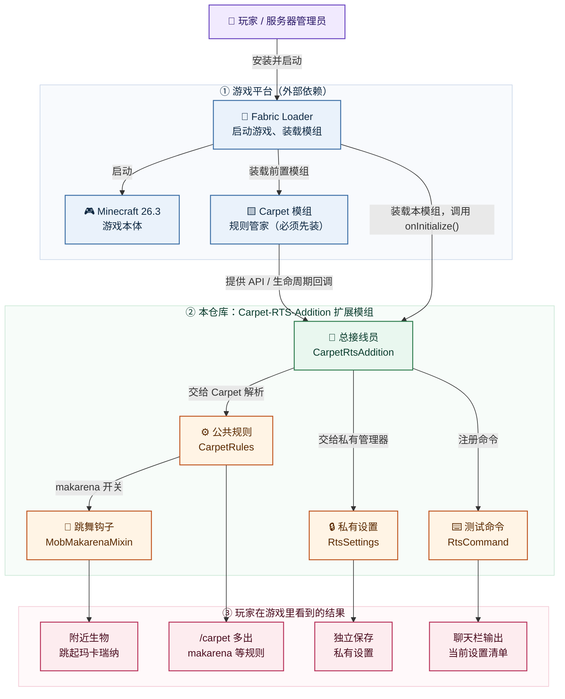
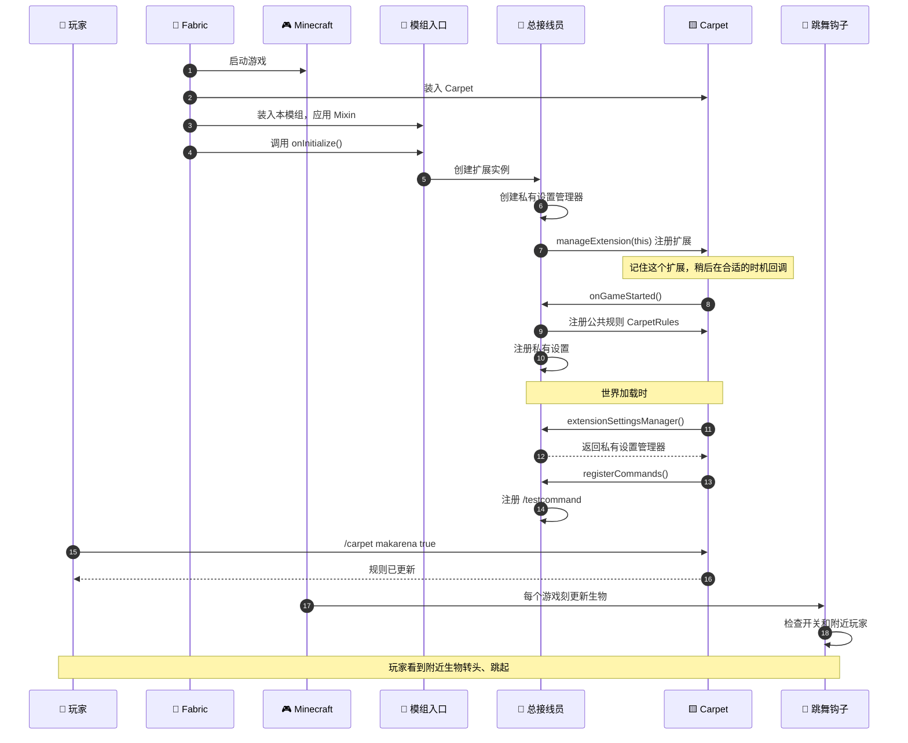

# Carpet-RTS-Addition 项目架构说明

> **一句话**：这是给 Minecraft 的 **Carpet** 模组加功能的“扩展插件”，不是一个独立游戏。
> 它往 `/carpet` 里加规则、加一个 `/testcommand` 命令，还附赠一个“让附近生物跳玛卡瑞纳”的小彩蛋。

**技术坐标**：Minecraft `26.3` · Fabric Loader `0.19.5` · Fabric Loom `1.18` · Carpet `26.3` · Java 25  
**代码规模**：6 个 Java 文件；2 个 JSON 配置；1 张图标  
**架构模式**：宿主（Carpet）+ 插件（本模组）+ 入口（ModInitializer）+ 钩子（Mixin）

---

## 0. 先看结论

- 本仓库不是“从零写的游戏”，而是 Carpet 的**扩展**。没有 Carpet，它不能工作。
- 它没有传统 `main` 方法。Fabric 的 `entrypoints.main` 指向 `CarpetRtsAddition`，由 Fabric 调用 `onInitialize()` 完成注册。
- 它有两套设置：一套并进 `/carpet`，一套自己管、独立保存。
- 它只有一个 Mixin：负责让生物跳舞；旧的 `CrashReport` 启动钩子已经移除。
- `README.md` 已替换为本项目的构建说明。

---

## 1. 仓库结构

```text
Carpet-RTS-Addition/
├─ build.gradle                  # 构建配方：依赖哪些版本、怎么打包
├─ gradle.properties             # 版本号集中管理（MC / Carpet / 模组版本）
├─ settings.gradle               # Gradle 插件仓库
├─ gradlew / gradlew.bat         # 自带 Gradle 启动脚本，无需预装 Gradle
├─ gradle/wrapper/               # Gradle 版本锁定文件
├─ README.md                     # 构建说明与工具链版本
├─ LICENSE                       # CC0
└─ src/main/
   ├─ java/carpet_rts_addition/
   │  ├─ CarpetRtsAddition.java       # 模组入口 / 扩展生命周期（ModInitializer）
   │  ├─ CarpetRules.java             # 并进 /carpet 的公共规则
   │  ├─ RtsSettings.java             # 独立保存的私有设置
   │  ├─ RtsCommand.java              # /testcommand 命令
   │  └─ mixins/
   │     └─ MobMakarenaMixin.java     # 生物跳舞钩子
   └─ resources/
      ├─ fabric.mod.json          # 模组身份证：ID、版本、依赖、入口
      ├─ carpet-rts-addition.mixins.json  # 钩子清单：现在只加载跳舞 Mixin
      └─ assets/carpet_rts_addition/icon.png    # 模组图标
```

**怎么读这棵树：**

- `src/main/java` 是“做什么”；
- `src/main/resources` 是“怎么被加载”；
- `build.gradle` / `gradle.properties` 是“用什么版本、怎么打包”；
- `gradlew` 是自带的小型构建启动器。

**说明：**

- 模组 ID、入口类、Mixin 配置、Java 包名和资源目录现在统一使用 `carpet-rts-addition` / `carpet_rts_addition`。

---

## 2. 整体架构图



> 如果当前编辑器不渲染 Mermaid，可以直接看 [架构图预览](architecture-preview.png)。

**顺着箭头读**：玩家 → Fabric → 启动钩子 → 总接线员 → 四个功能模块 → 四个结果；Carpet 是必须先装的前置，向总接线员提供规则/API 和生命周期回调。

**读图提示：**

- **蓝色**是游戏平台/前置模组，**绿色**是启动与协调，**橙色**是本模组的功能模块，**粉色**是玩家可见结果。
- 每个框先看第一行的中文角色，再看第二行的类名；不懂类名不影响理解关系。
- `Carpet` 是前置，`Fabric` 负责把 Carpet 和本模组都装进游戏；本模组再“插”到 Carpet 上。
- 跳舞钩子是 Mixin 注入点：插在生物每刻更新处；启动则走 Fabric 的 `ModInitializer`，不再使用 Mixin。

**名词小抄：**

| 名词 | 用大白话解释 |
|---|---|
| Fabric Loader | 模组加载器，负责把 jar 装进游戏、把 Mixin 应用进去 |
| Carpet | 规则管家，提供 `/carpet` 命令、设置系统和扩展接口 |
| Mixin | 一种“不改游戏源码，也能往游戏原有流程里插一段代码”的技术 |
| SettingsManager | 管理一组设置，负责解析规则、读写配置文件 |
| 生命周期回调 | Carpet 在启动、世界加载、命令注册等时机主动来调用你的代码 |
| Gradle / Loom | 打包工具：下载依赖、编译 Java、生成可安装的 jar |

---

## 3. 模块清单

| 模块 | 代码/文件 | 一句话职责 | 谁在什么时候用它 |
|---|---|---|---|
| 模组入口 | `CarpetRtsAddition#onInitialize` | Fabric 调用，创建设置管理器并向 Carpet 注册扩展 | Fabric Loader 启动时 |
| 总接线员 | `CarpetRtsAddition` | 实现 `CarpetExtension`，接收生命周期回调 | Carpet 在启动、世界加载、命令注册时 |
| 公共规则 | `CarpetRules` | 定义 `makarena`、`numericalSetting`，并入 `/carpet` | Carpet 的 `SettingsManager` |
| 私有设置 | `RtsSettings` | 定义整数、字符串、枚举、布尔四个设置，独立保存 | 自己的 `SettingsManager` |
| 测试命令 | `RtsCommand` | 注册 `/testcommand first` 和 `/testcommand second` | Carpet 的命令注册回调 |
| 跳舞钩子 | `MobMakarenaMixin` | 每游戏刻检查开关，让附近生物转头、跳起 | Minecraft 的生物更新 |
| 模组身份证 | `fabric.mod.json` | 声明 ID、版本、依赖 Carpet、Mixin 清单 | Fabric Loader 装载时 |
| 钩子清单 | `carpet-rts-addition.mixins.json` | 列出要加载的 Mixin（现在只有跳舞钩子） | Mixin 子系统 |

**补充说明：**

- `CarpetRtsAddition` 还注册了一个**规则观察器**，用来演示监听 `/carpet` 规则变化；它不属于核心架构，主图里省略了。
- `onServerLoaded`、`onTick`、玩家登录/登出这些回调在示例里是空的，属于“留给你填”的扩展点。
- `carpet-rts-addition.mixins.json` 里 `defaultRequire: 1` 表示：只要有一个 Mixin 注入失败，游戏就直接报错，不会静默跳过。

---

## 4. 三条关键关系

### 4.1 没有 `main` 方法，由 Fabric 入口启动

`fabric.mod.json` 的入口指向扩展类：

```json
"entrypoints": {
  "main": ["carpet_rts_addition.CarpetRtsAddition"]
}
```

真正的启动链是：

1. Fabric 装载 jar，读取 `fabric.mod.json`，按 `carpet-rts-addition.mixins.json` 应用 Mixin。
2. Fabric 调用 `CarpetRtsAddition.onInitialize()`。
3. `onInitialize()` 创建私有设置管理器 `settingsManager`，并调用 `CarpetServer.manageExtension(this)` 把自己注册给 Carpet。
4. Carpet 记住这个扩展，之后在 `onGameStarted()`、`registerCommands()`、世界加载等时机回调它。
5. 在 `onGameStarted()` 中把 `CarpetRules` 交给 Carpet 的 `/carpet`，把 `RtsSettings` 交给私有管理器。

**为什么不再用 Mixin 启动？** 旧版为了抢 Carpet 的加载时机，注入了 Minecraft 内部的 `CrashReport#initCrashReport`；这个内部方法名在版本升级时很容易失效。Carpet 26.x 明确支持从 Fabric `ModInitializer` 注册扩展，因此启动更稳定，也不再需要这个钩子。

### 4.2 两套设置，两种“户口”

| | 公共规则 | 私有设置 |
|---|---|---|
| 类 | `CarpetRules` | `RtsSettings` |
| 管理者 | Carpet 的 `CarpetServer.settingsManager` | 自己的 `settingsManager` |
| 怎么进入游戏 | `CarpetServer.settingsManager.parseSettingsClass(...)` | `settingsManager.parseSettingsClass(...)` |
| 玩家在哪看到 | `/carpet` 的规则列表 | 独立设置管理器（`/testcommand second` 可查看当前值） |
| 存哪 | Carpet 的 `carpet.conf` | 自己的配置文件，不挤进 `carpet.conf` |
| 典型内容 | `makarena`、`numericalSetting` | `intSetting`、`stringSetting`、`optionSetting`、`boolSetting` |

`CarpetRtsAddition.extensionSettingsManager()` 返回 `settingsManager`，作用是告诉 Carpet：“这套设置由我自己的管理器负责，世界加载时请用它来读写。”

> 26.3 升级提示：Carpet 的新 API 要求新式 `carpet.api.settings.Rule` 使用翻译键；为了让本模组继续使用带 `desc`/`extra` 的旧式注解，私有管理器仍实例化 `carpet.settings.SettingsManager`（已标记为 deprecated，但 26.3 仍可用）。

### 4.3 一个开关，如何变成舞蹈

这条链是理解本项目最好的例子：

```text
玩家在聊天栏输入 /carpet makarena true
        ↓
CarpetRules.makarena 变成 true
        ↓
每个游戏刻，MobMakarenaMixin 都会检查这个值
        ↓
如果生物站在地上、附近 32 格内有玩家：
  - 每 200 tick 一个循环（约 10 秒）
  - 最后约 2.2 秒持续转头
  - 循环最后一下向上跳
        ↓
玩家看到附近的生物在“跳玛卡瑞纳”
```

这也是“设置 → 行为”的最小闭环：**命令改设置，Mixin 读设置，游戏表现变化**。

---

## 5. 附：启动时序



---

## 6. 附：构建流水线


构建命令：

```bash
# macOS / Linux
./gradlew build

# Windows
.\gradlew.bat build
```

产物在 `build/libs/` 下。`build.gradle` 里的 `processResources` 会把 `fabric.mod.json` 的 `${version}` 替换成 `gradle.properties` 中的 `mod_version`（当前为 `26.3`）。

**构建注意（26.3 工具链）：**

- 项目要求 **JDK 25**：`options.release = 25`，并配置了 Java 25 toolchain。
- Minecraft 26.x 使用官方未混淆名，因此 `build.gradle` **不再声明 Yarn mappings**。
- Carpet 依赖改为 Modrinth Maven：`maven.modrinth:carpet:26.3`。
- `settings.gradle` 已移除停用的 `jcenter()`，改用 `mavenCentral()`。
- 仓库没有测试目录，功能验证靠进游戏执行 `/carpet` 和 `/testcommand`。

---

## 7. 一句话总结

**Fabric 把 jar 装进游戏 → 启动钩子叫醒总接线员 → 总接线员向 Carpet 注册两套设置和一个命令 → 设置值又反过来控制跳舞钩子。**

---

*本文档已按 Minecraft 26.3 / Java 25 工具链更新。*
