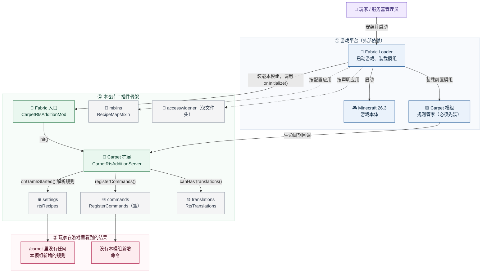

# Carpet-RTS-Addition 项目架构说明

> **一句话**：这是一个 **Carpet 扩展模组的最小骨架** —— 它能被 Fabric 装进游戏、能被 Carpet 识别为扩展，
> 但当前**没有任何规则、命令或 Mixin**。功能将在后续按需逐个加回来。

**技术坐标**：Minecraft `26.3` · Fabric Loader `0.19.5` · Fabric Loom `1.18-SNAPSHOT` · Carpet `26.3` · Java 25  
**代码规模**：6 个 Java 文件（其中 2 个为空包的 package-info）；1 个模组元数据；1 个 mixin 配置；1 个 access widener  
**架构模式**：宿主（Carpet）+ 插件（本模组）+ 入口拆分（`Mod` / `Server`）+ 分包（settings / translations / commands / mixins / utils）

---

## 0. 当前状态

| 项 | 状态 |
|---|---|
| Fabric 入口 | `CarpetRtsAdditionMod implements ModInitializer`，读版本号后调用 `CarpetRtsAdditionServer.init()` |
| Carpet 扩展 | `CarpetRtsAdditionServer implements CarpetExtension`，单例 + `init()` 里 `CarpetServer.manageExtension` |
| 规则 | `settings/CarpetRtsAdditionSettings#rtsRecipes`、`#infiniteBuckets`（默认均为 `false`）+ `CarpetRuleRegistrar` 包装 `parseSettingsClass` |
| 命令 | `commands/RegisterCommands`（空方法，已接进 `registerCommands` 回调） |
| Mixin | `mixins/RecipeMapMixin`：`rtsRecipes` 关闭时剔除本模组配方的匹配与按 ID 查询<br/>`mixins/EnchantmentMixin`：`infiniteBuckets` 开启时允许给水桶/熔岩桶附魔无限<br/>`mixins/BucketItemMixin`：附有无限的水桶/熔岩桶使用后返回副本，不变成空桶 |
| Access Widener | `carpet-rts-addition.accesswidener` 仅有文件头，已在 `build.gradle` 与 `fabric.mod.json` 登记 |
| 翻译 | `translations/RtsTranslations` 接进 `canHasTranslations()`，从 `assets/carpet_rts_addition/lang/<lang>.json` 读取 |

`CarpetExtension` 其余回调（`onServerLoaded`、`onTick`、`onReload`、`scarpetApi` 等）保持接口默认实现。
Carpet 的 `CarpetServer.forEachManager` 对 `extensionSettingsManager() == null` 有判空，
本模组没有自己的 `SettingsManager`，规则直接进 Carpet 主管理器。

`CarpetExtension` 的其余回调（`onGameStarted`、`onServerLoaded`、`registerCommands`、
`extensionSettingsManager`、`canHasTranslations` 等）全部使用接口默认实现：不覆写即为空操作。
Carpet 的 `CarpetServer.forEachManager` 对 `extensionSettingsManager() == null` 有判空，
因此空扩展不会导致崩溃。

---

## 1. 仓库结构

```text
Carpet-RTS-Addition/
├─ build.gradle                  # 构建配方：依赖版本、打包规则
├─ gradle.properties             # 版本集中管理（MC / Carpet / 模组版本）
├─ settings.gradle               # Gradle 插件仓库
├─ gradlew / gradlew.bat         # 自带 Gradle 启动脚本
├─ gradle/wrapper/               # Gradle 版本锁定
├─ README.md / ARCHITECTURE.md   # 构建说明与本文档
├─ architecture.mmd              # 与 §2 对应的 Mermaid 源文件
├─ LICENSE                       # CC0
└─ src/main/
   ├─ java/carpet_rts_addition/
   │  ├─ CarpetRtsAdditionMod.java     # Fabric 入口（ModInitializer）
   │  ├─ CarpetRtsAdditionServer.java  # Carpet 扩展单例（CarpetExtension）
   │  ├─ settings/
   │  │  ├─ CarpetRtsAdditionSettings.java  # 规则声明（当前为空）
   │  │  └─ CarpetRuleRegistrar.java        # 把规则类交给 SettingsManager
   │  ├─ translations/
   │  │  └─ RtsTranslations.java       # 语言文件加载 + canHasTranslations
   │  ├─ commands/
   │  │  └─ RegisterCommands.java      # 命令注册入口（当前为空）
   │  ├─ mixins/
   │  │  ├─ RecipeMapMixin.java         # 规则关闭时过滤配方查询
   │  │  └─ package-info.java           # Mixin 包声明
   │  └─ utils/package-info.java       # 公共工具包（当前为空）
   └─ resources/
      ├─ fabric.mod.json                        # 模组身份证：ID、入口、依赖、mixin、access widener
      ├─ carpet-rts-addition.mixins.json        # Mixin 配置（已登记 RecipeMapMixin）
      ├─ carpet-rts-addition.accesswidener      # Access Widener（仅文件头）
      ├─ assets/carpet_rts_addition/
      │  ├─ icon.png                            # 模组图标
      │  └─ lang/en_us.json                     # 规则描述词条
      └─ data/carpet_rts_addition/recipe/*.json # 39 个配方（注册表路径，单数 recipe）
```

---

## 2. 整体架构图



---

## 3. 启动链

1. Fabric 装载 jar，读取 `fabric.mod.json`：确认 `carpet` 依赖、登记 `carpet-rts-addition.mixins.json`
   与 `carpet-rts-addition.accesswidener`。
2. Fabric 调用 `CarpetRtsAdditionMod.onInitialize()`：用 `FabricLoader` 读出模组版本，然后调用
   `CarpetRtsAdditionServer.init()`。
3. `init()` 里 `CarpetServer.manageExtension(INSTANCE)`，把单例登记为 Carpet 扩展。
4. Carpet 在合适时机回调：`onGameStarted()` 里由 `CarpetRuleRegistrar` 把
   `CarpetRtsAdditionSettings` 交给 `CarpetServer.settingsManager` 解析；
   `registerCommands()` 转给 `RegisterCommands`；
   刷新语言时经 `canHasTranslations()` 取 `RtsTranslations` 的词条。

没有传统 `main` 方法，也没有 Mixin 参与启动。

---

## 4. 为什么保留了配方数据

`src/main/resources/data/carpet_rts_addition/recipes/` 下的 43 个 JSON 是为后续功能预留的，
本次不删除。**注意它们是真实生效的模组数据**：这些文件会作为模组自带数据包被加载，
例如 `chest.json` 把「3×3 原木」合成 4 个箱子。也就是说：

- **代码层面**本模组是空白的（无规则 / 命令 / Mixin）；
- **游戏内容层面**它仍会改写这些配方。

若要做成"行为上完全空白"，需要把 `data/` 移出 `resources`（或加数据包过滤）——
这属于另一项决策，本次未执行。

---

## 5. 加回第一个功能时的落点

| 想加的东西 | 落点 |
|---|---|
| Carpet 规则 | `settings/CarpetRtsAdditionSettings` 里加 `@carpet.api.settings.Rule` 注解的 `public static` 字段；描述写进 `assets/carpet_rts_addition/lang/en_us.json` 的 `carpet.rule.<字段名>.desc` |
| 命令 | `commands/RegisterCommands.registerCommands(dispatcher)` |
| 行为注入 | `mixins/` 下新建 Mixin 类，并把全限定名（相对包）加进 `carpet-rts-addition.mixins.json` 的 `mixins` / `client` / `server` 列表 |
| 访问私有成员 | 在 `carpet-rts-addition.accesswidener` 里加 `accessible class …` 行（文件头不能改、不能存 BOM） |

规则注册走 `CarpetRuleRegistrar` → `SettingsManager.parseSettingsClass`，没有反射、没有自定义注解。

---

## 6. 与 TIS / AMS 的架构对应关系

| 它们的做法 | 本仓库 | 原因 |
|---|---|---|
| `XxxMod` + `XxxServer` 双类入口 | 照搬 | 与版本无关，职责清晰 |
| `settings / translations / commands / mixins / utils` 分包 | 照搬 | 与版本无关 |
| `XxxPreLaunch`（`preLaunch` entrypoint） | 未采用 | 它们的用途是多版本预处理器初始化，本仓库单版本 |
| `AutoMixinAuditExecutor` | 未采用 | 依赖 MixinExtras 的审计工具，开发期辅助，当前无 Mixin |
| `com.replaymod.preprocess` + `versions/` | 未采用 | 单版本 26.3，没有需要预处理的代码分支 |
| 自定义 `@Rule` + 反射 `ParsedRule` 私有构造器（AMS） | **未采用** | 那是为兼容 MC < 1.19.4 的旧 Carpet API；26.3 的原生 `carpet.api.settings.Rule` 已具备 `categories/options/strict/validators`，反射内部构造器只会引入运行时失效风险 |
| `accessWidener` + `mixins` 接线 | 照搬 | 后续加功能必然要用，先接线 |
| LGPL-3.0 文件头 | 不照搬许可 | 本仓库是 CC0-1.0，只保留"每个文件有统一头"的形式 |

---

## 7. 配方与 `rtsRecipes` 规则

### 7.1 事实基线（全部实测或字节码核实）

- 26.x 的配方是**注册表数据**：`Registries.RECIPE`，注册表 key 路径为 `recipe`，
  因此目录必须是 `data/<namespace>/recipe/`（**单数**）。
- 模组的 `data/` 需要 `fabric-resource-loader-v0` 才会被当成数据包加载。
  本项目因此加了 Fabric API 依赖；否则 `/datapack list` 只有 `vanilla`，所有配方文件被忽略。
- 注册表**不能在运行时增删条目**，所以规则不可能通过"加/删配方"实现。
- AMS 的 `Server#registerCustomRecipes(map, lookup)` 不是 Carpet 钩子（扫描 carpet 26.3 jar，
  `registerCustomRecipes` / `buildCustomRecipeJson` 均不存在），它是 AMS 自己的方法，
  由它的 `RecipeManagerMixin` 调用。

### 7.2 实现方式

`mixins/RecipeMapMixin` 在 `RecipeMap` 的两个查询点做过滤（开关关闭时）：

| 注入点 | 作用 |
|---|---|
| `RecipeMap#getRecipesFor(RecipeType, RecipeInput, Level)` | 工作台匹配：返回的流里剔除本模组配方，原版候选不受影响 |
| `RecipeMap#byKey(ResourceKey)` | 按 ID 精确查找：返回 `null`（`RecipeManager.byKeyTyped` 有判空，不会 NPE） |

"本模组配方"的判定：配方 ID 的命名空间等于 `carpet_rts_addition`。
过滤发生在查询期，所以切换规则**立即生效**，不需要 `/reload` 或重进世界。

### 7.3 实测结果（开发服务器 + RCON）

| 规则状态 | 命令 | 结果 |
|---|---|---|
| 关（默认） | `/recipe give @a carpet_rts_addition:chest` | `Unknown recipe` ✅ 被拦 |
| 开 | `/recipe give @a carpet_rts_addition:chest` | `Unlocked 1 recipe(s)` ✅ |
| 开 | `/recipe give @a carpet_rts_addition:barrel`（标签型配方） | `Unlocked 1 recipe(s)` ✅ |
| 再关 | `/recipe give @a carpet_rts_addition:composter` | `Unknown recipe` ✅ 动态生效 |
| 任意 | `/recipe give @a minecraft:chest`（对照） | `Unlocked 1 recipe(s)` ✅ 未误伤原版 |

`/datapack list` 实测输出包含 `[carpet-rts-addition (Fabric mod)]`，且 39 个配方解析无报错。

### 7.4 已知限制

- 配方书的 **display 列表**在 `RecipeManager.finalizeRecipeLoading()` 时一次性构建，
  关闭规则并不会从已同步给客户端的列表里撤下，所以关闭状态下可能仍能看到条目，
  但点击/合成会被 `byKey` / `getRecipesFor` 拦住。
- 若要"关闭时连配方书都不显示"，只能在加载/重载阶段过滤，代价是切换需要 `/reload`
  （见 §5 的 A/B 方案对比，当前实现选的是 A）。

---

## 8. `infiniteBuckets` 规则（无限桶）

### 8.1 两个注入点

| Mixin | 注入点 | 作用 |
|---|---|---|
| `EnchantmentMixin` | `Enchantment#canEnchant(ItemStack)` HEAD | 规则开启时，若 `this` 是无限附魔且物品是水桶/熔岩桶 → 直接返回 `true` |
| `BucketItemMixin` | `BucketItem#getEmptySuccessItem(ItemStack, Player)` HEAD | 规则开启且桶带无限 → 返回**副本**，让 `use()` 的返回值仍是这只桶 |

`canEnchant` 是铁砧与 `/enchant` 共用的判定（字节码核实：`AnvilMenu.createResult` 与 `EnchantCommand` 都调它），
所以一处注入同时覆盖两条附魔路径。附魔台不适用：桶没有 `enchantable` 组件，附魔台本身不会给它附魔。

### 8.2 为什么必须返回副本（实测踩坑）

`BucketItem#use` 在成功放置流体后执行：

```java
ItemStack result = ItemUtils.createFilledResult(stack, player, getEmptySuccessItem(stack, player));
return InteractionResult.SUCCESS.heldItemTransformedTo(result);
```

而 `createFilledResult` 在生存模式下会先 `stack.consume(1, player)`，再判断 `stack.isEmpty()`。
若 `getEmptySuccessItem` 返回**同一个实例**，`consume` 会把它清空，于是玩家手里什么都不剩（桶直接消失）。
返回 `stack.copy()` 才能既保留附魔，又绕过消耗。创造模式下走的是另一条分支（不消耗），行为不变。

### 8.3 无限附魔如何识别

附魔是数据包注册表（`Registries.ENCHANTMENT`），`/reload` 会重建实例，所以**不能缓存实例做身份比较**。
`utils/InfinityEnchantment` 在每次判定时从当前服务器的 `registryAccess()` 取 `Enchantments.INFINITY` 的 Holder：

- `isInfinity(Enchantment)`：`holder.value() == enchantment`
- `hasInfinity(ItemStack)`：`EnchantmentHelper.getItemEnchantmentLevel(holder, stack) > 0`

服务器引用在 `onServerLoaded` 里挂上、`onServerClosed` 里清掉，客户端线程调用时返回 `false`（保持原版行为）。

### 8.4 实测结果（开发服务器 + RCON，生存模式）

| 场景 | 结果 |
|---|---|
| 规则关，对水桶 `/enchant infinity` | `Water Bucket cannot support that enchantment` ✅ |
| 规则开，对水桶 `/enchant infinity` | `Applied enchantment Infinity` ✅ |
| 规则开，生存模式放置水 | 水已放置、水桶仍在、无空桶 ✅ |
| 规则开，生存模式放置岩浆 | 岩浆已放置、岩浆桶仍在 ✅ |
| 规则关，同一只带无限的桶放置水 | 水已放置、水桶消失、得到空桶 ✅ |
| 规则开，对空桶 / 石头 `/enchant infinity` | 均被拒绝 ✅（只放行水桶/熔岩桶） |

副作用说明：创造模式下铁砧会跳过 `canEnchant`（vanilla 行为，字节码中 `hasInfiniteMaterials()` 分支），
所以规则关闭时创造模式仍可经**铁砧**给桶附魔，只是不会有无限效果；`/enchant` 没有这个豁免，实测创造模式同样被拒绝。

## 9. 构建

```bash
# Windows
.\gradlew.bat build

# macOS / Linux
./gradlew build
```

产物在 `build/libs/`。`processResources` 会把 `fabric.mod.json` 的 `${version}`
替换成 `gradle.properties` 中的 `mod_version`（当前 `26.3`）。

**26.3 工具链要点：**

- 需要 **JDK 25**：`options.release = 25`，并配置了 Java 25 toolchain。
- Minecraft 26.x 使用官方未混淆名，`build.gradle` 不声明 Yarn mappings。
- Carpet 依赖走 Modrinth Maven：`maven.modrinth:carpet:26.3`。
- 仓库没有测试目录，验证方式是构建成功 + 进游戏确认 `/carpet` 中没有本模组新增的规则。
